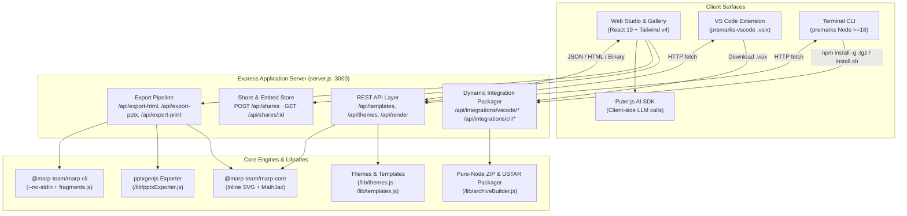
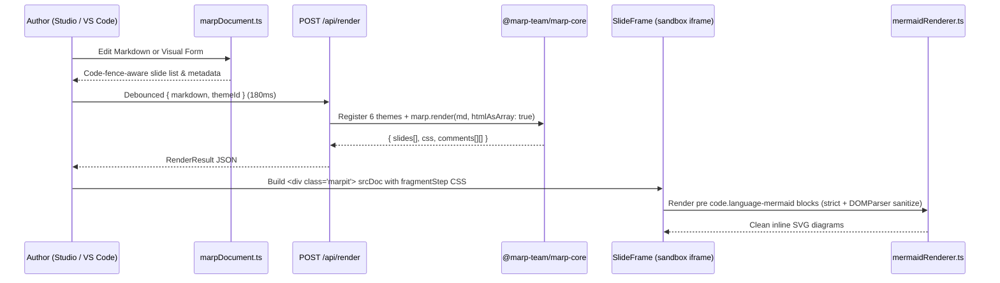
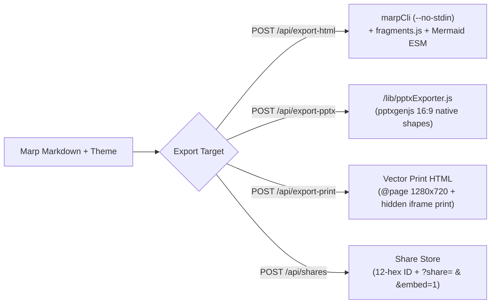
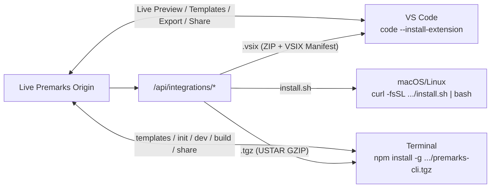

# Premarks — Technical Architecture & Engineering Report

## 1. Executive Summary, Aim & Project Objectives

### 1.1 Project Aim
**Premarks** (evolved from `ajeetkbhardwaj/premarks`) is a full-stack Markdown presentation engineering platform built on top of the **Marp** ecosystem (`@marp-team/marp-core` and `@marp-team/marp-cli`). Its primary aim is to replace slow, proprietary slide software and fragmented formatting tools with a fast, developer- and educator-friendly presentation studio where decks are authored in portable Markdown, styled via curated discipline-targeted themes, enriched with equations and diagrams, and distributed seamlessly across web browsers, PowerPoint, print/PDF, Visual Studio Code, and the terminal.

### 1.2 Core Goals & Objectives
1. **Discipline-Specific Presentation Templates**: Deliver ready-to-present, multi-slide templates tailored for STEM & Math, Engineering & Systems, Business & Strategy, Design & Product, and Editorial & Humanities—so users start from structured domain layouts rather than blank canvases.
2. **Dual-Surface Authoring (Zero-Barrier Creation)**: Let both non-technical presenters and power users build slides effortlessly using either a structured **Visual Form** (layout picker, quick element pills, speaker notes) or raw **Marp Markdown** with live 16:9 rendering, slide density guards, and a grid overview sorter.
3. **No-Code Brand Customization**: Enable custom headers, footers, pagination, color palettes (`--accent`, `--bg`, `--ink`), typography, and corner brand logos via a **Brand Kit** drawer that safely serializes into Marp YAML frontmatter (`style: |`).
4. **AI-Assisted & Data-Driven Productivity**:
   - Integrate **Puter.js** client-side AI (`window.puter.ai.chat`) to generate full multi-slide decks from topics/notes, polish slide layouts, and synthesize speaker notes.
   - Provide deterministic **Smart Importers** that turn plain outlines into slide decks and convert CSV/TSV/JSON datasets into styled Markdown tables, KPI metric rows, or Mermaid charts.
5. **Multi-Format Portability Without Heavy Runtime Dependencies**: Compile and export decks to self-contained animated HTML (`fragments.js` + Mermaid), editable 16:9 PowerPoint (`.pptx`), vector Print/PDF HTML, and `.md` source—engineered to run cleanly even in headless Linux containers without Chromium or LibreOffice.
6. **Ubiquitous Developer Integrations**: Meet users inside the tools they already live in via a downloadable, preconfigured **VS Code Extension (`.vsix`)**, an installable zero-dependency **Terminal CLI (`premarks`)**, GitHub Actions CI/CD snippets, embeddable `<iframe>` links, and a public REST API.

---

## 2. System Architecture Overview

Premarks follows a unified Node.js + Express full-stack architecture (`server.js`) that serves a React/Vite TypeScript SPA in development (`vite` middleware) or static `dist/` assets in production, backed by Marp compilation engines, native PPTX synthesis, in-memory/tmp-persisted share links, and dynamic pure-Node extension/CLI packaging.



---

## 3. Repository & Project Structure

```text
/
├── index.html                          # SPA entry HTML; loads Google Fonts & Puter.js v2 SDK
├── metadata.json                       # Application metadata & capabilities manifest
├── package.json                        # Scripts (dev, build, start, lint, html, pdf, pptx) & deps
├── tsconfig.json                       # TypeScript compiler configuration
├── vite.config.ts                      # Vite + React + Tailwind v4 configuration
├── server.js                           # Unified Express server (API, Marp compiler, packager, SPA host)
├── theme.css                           # Base "anime" Marp theme (CSS variables, animations, cards)
├── fragments.js                        # Client runtime injected into exported HTML for click-to-reveal steps
├── inject-fragments.js                 # Post-build CLI helper injecting fragments.js into slides.html
├── slides.md                           # Flagship Algebraic Geometry showcase deck source
├── slides.html                         # Compiled standalone showcase deck HTML
├── slides.pdf                          # Pre-built static showcase PDF
├── tech-rep.md                         # This technical architecture & engineering report
│
├── lib/                                # Server-side engines & curated asset catalogs
│   ├── themes.js                       # 6 Marp CSS themes + shared animation/layout/Mermaid grammar
│   ├── templates.js                    # 8 discipline-targeted templates across 5 fields
│   ├── pptxExporter.js                 # Node-native 16:9 PowerPoint (.pptx) generator via pptxgenjs
│   └── archiveBuilder.js               # Zero-dependency ZIP (.vsix) & USTAR tar.gz (.tgz) builder
│
├── src/                                # Frontend React + TypeScript application
│   ├── main.tsx                        # React 19 root mount
│   ├── index.css                       # Tailwind v4 import & @custom-variant dark configuration
│   ├── vite-env.d.ts                   # Vite client asset/CSS module type declarations
│   ├── types.ts                        # Shared TypeScript interfaces & Window.puter augmentation
│   ├── App.tsx                         # Top-level state, 3-zone navigation, ?share= & embed router
│   ├── utils/
│   │   ├── marpDocument.ts             # Code-fence-aware slide splitter, YAML helpers, Marpit wrapper
│   │   ├── brandKit.ts                 # Brand Kit YAML/CSS serializer, Visual Form parser, STEM/Mermaid snippets
│   │   ├── deckTransformers.ts         # Outline-to-deck, CSV/JSON-to-table/KPI/chart, density & split utils
│   │   ├── mermaidRenderer.ts          # Strict-mode Mermaid SVG renderer + DOMParser sanitizer & cache
│   │   └── puterAi.ts                  # Puter.js AI wrapper (deck generation, slide polish, speaker notes)
│   └── components/
│       ├── TemplatesView.tsx           # Template gallery, field/style filters, search, service directory
│       ├── StudioView.tsx              # Filmstrip, Grid sorter, Visual/Markdown editor, Snapshots, Find/Replace
│       ├── BrandKitDrawer.tsx          # No-code slide drawer for headers, footers, colors, fonts & logo
│       ├── SlideFrame.tsx              # Sandboxed 16:9 iframe slide renderer with Mermaid & fragment stepping
│       ├── ThemesView.tsx              # 6-theme showcase with color swatches & live Slide 1 previews
│       ├── MyDecksView.tsx             # localStorage-backed deck manager + .md file importer
│       ├── PresenterModal.tsx          # Fullscreen Audience player & Speaker Console (timer + teleprompter)
│       ├── AiDeckModal.tsx             # Puter.js AI Presentation Writer modal
│       ├── ImportTransformModal.tsx    # Outline-to-Deck & CSV/JSON-to-Table/KPI/Chart modal
│       └── IntegrationsView.tsx        # VS Code .vsix downloader, CLI installer/builder, CI & REST API hub
│
├── integrations/
│   └── vscode-extension/               # Installable Visual Studio Code extension source
│       ├── package.json                # Extension manifest (commands, keybindings, menus, snippets, config)
│       ├── extension.js                # Live webview preview, template picker, exports, share publisher
│       ├── README.md                   # Extension setup & shortcut documentation
│       └── snippets/
│           └── premarks.json           # 7 Markdown snippets (pm-frontmatter, pm-cards, pm-formula, etc.)
│
└── cli/                                # Zero-dependency Node.js CLI package ("premarks")
    ├── package.json                    # CLI package manifest (bin: ./bin/premarks.js, engines: >=18)
    ├── README.md                       # CLI installation & command guide
    └── bin/
        └── premarks.js                 # Executable CLI (templates, themes, init, dev, build, share, config)
```

---

## 4. Core Presentation & Compilation Pipeline

### 4.1 Marp Theme System (`/theme.css` & `/lib/themes.js`)
Premarks defines **six cohesive Marp CSS themes** (`anime`, `theorem`, `swiss`, `executive`, `obsidian`, `monograph`). All themes share a unified structural and motion grammar so templates remain portable across themes:
- **Layout Classes (`<!-- _class: ... -->`)**: `lead`, `section`, `split`, `centered`, `quote`, `closing`, and `animate-in`.
- **Component Classes**: `.eyebrow`, `.row`, `.card`, `.formula-box`, `.table-wrap`, `.mermaid-diagram`, and `blockquote`.
- **Motion & Fragments**: Entrance transitions (`fade`, `rise`, `veil`, `focus`, `zoom`, `slide`) paired with `[data-fragment="N"]` click-to-reveal choreography driven by `/fragments.js` in standalone HTML exports and simulated step-by-step in `SlideFrame.tsx`.

### 4.2 Marp Core Rendering & Selector Scoping (`/server.js` & `/src/utils/marpDocument.ts`)
During interactive editing, `POST /api/render` invokes `@marp-team/marp-core` (`new Marp({ html: true, inlineSVG: true, math: 'mathjax' })`) with `{ htmlAsArray: true }`.
- Marp Core compiles every slide into an inline `<svg data-marpit-svg>` containing a `<foreignObject><section>...</section></foreignObject>` and scopes theme CSS selectors under `div.marpit > svg > foreignObject > section`.
- Because of this selector contract, `buildSlideFrameDocument()` in `/src/utils/marpDocument.ts` wraps every single-slide `srcDoc` inside `<div class="marpit">...</div>` so theme typography, layout grids, and Brand Kit `:root` variable overrides resolve with full fidelity inside isolated `<iframe sandbox="">` viewports.
- On server startup, `/server.js` pre-renders Slide 1 for all 8 templates in `/lib/templates.js` into `enrichedTemplates` so `GET /api/templates` delivers instant visual previews without client round-trips.



### 4.3 Code-Fence-Aware Slide Parsing & Visual Form (`/src/utils/marpDocument.ts`, `/src/utils/brandKit.ts`)
- **Slide Splitting**: `splitMarpDocument()` parses YAML frontmatter and splits slide bodies on `---` delimiters while tracking fenced code blocks (` ``` `) so horizontal rules or YAML examples inside code blocks never corrupt slide boundaries.
- **Bidirectional Visual Form**: `parseVisualSlideFields()` and `serializeVisualSlideFields()` extract `_class`, `transition`, `<span class="eyebrow">`, `# Heading`, body Markdown, and `<!-- speaker notes -->` comments into structured form controls, while keeping raw Markdown in sync as the single source of truth.
- **Brand Kit Injection**: `extractBrandKit()` and `applyBrandKit()` manage `header`, `footer`, `paginate`, and an inline `style: |` YAML block injecting `:root { --accent; --bg; --ink; --brand-logo; }`, custom `section { font-family }`, and `section::after` corner logo placement.

---

## 5. Multi-Format Export & Publishing Architecture

Because containerized cloud runtimes typically lack Chromium or LibreOffice binaries, Premarks implements a resilient multi-target export pipeline that operates cleanly in pure Node.js:



1. **Animated HTML (`POST /api/export-html`)**: Writes temporary theme CSS and Markdown to an isolated `os.tmpdir()` directory, invokes `marpCli` with `--no-stdin` (preventing non-TTY stdin hangs), injects `/fragments.js` and the fragment counter DOM node, appends an ESM Mermaid runtime if `.language-mermaid` blocks exist, and cleans up the temp directory in `finally`.
2. **Native PowerPoint (`POST /api/export-pptx` & `/lib/pptxExporter.js`)**: Parses each slide's frontmatter, theme palette swatches, headings, bullets, Markdown tables, fenced code blocks, and speaker notes into native 16:9 `pptxgenjs` slides, text boxes, accent bars, and speaker note payloads—producing genuine `.pptx` files editable in PowerPoint, Keynote, or Google Slides.
3. **Vector Print / PDF (`POST /api/export-print`)**: Compiles all slides into an un-animated vector SVG HTML document with `@page { size: 1280px 720px; margin: 0; }`, force-reveals all `[data-fragment]` elements, and triggers `iframe.contentWindow.print()` inside a hidden iframe so users can save crisp vector PDFs directly from the browser without popups.
4. **Shareable & Embeddable Links (`POST /api/shares` & `GET /api/shares/:id`)**: Assigns a 12-character cryptographic hex ID (`crypto.randomBytes(6).toString('hex')`), stores the deck in an in-memory `Map` backed by `os.tmpdir()/premarks-shares.json` (capped to recent 200 entries), and serves both interactive view (`?share=<id>`) and distraction-free `<iframe>` embeds (`?share=<id>&embed=1`).

---

## 6. Frontend Studio, Smart Authoring & Speaker Console

### 6.1 Navigation & State Management (`/src/App.tsx`)
`App.tsx` implements a strict three-zone top navigation bar (`Premarks` — `Templates`, `Studio`, `Style Themes`, `My Decks`, `Integrations` — `AI Deck Writer`), manages debounced live compilation (`180ms` AbortController-guarded fetch to `/api/render`), syncs saved decks to `localStorage` (`premarks.decks.v1`), and handles light/dark UI state via Tailwind CSS v4 `@custom-variant dark`.

### 6.2 Advanced Studio Capabilities (`/src/components/StudioView.tsx`, `/src/utils/deckTransformers.ts`)
- **Four Workspace Modes (`split | editor | preview | grid`)**: Includes a full **Slide Grid Overview** displaying rendered 16:9 thumbnails for every slide with direct reorder, duplicate, delete, and click-to-edit actions.
- **Visual Form++ & Snippet Menus**: One-click insertion of layout blocks (`2-Column Cards`, `Code Block`, `Table`, `Callout Quote`), 6 pre-built STEM LaTeX equations (`STEM_EQUATIONS`), and 3 Mermaid templates (`MERMAID_SNIPPETS`).
- **Slide Density Guard & One-Click Split**: `analyzeSlideDensity()` evaluates non-comment words and lines on the active slide; when a slide exceeds 135 words or 15 lines, a **Split Slide** button invokes `splitCrowdedSlide()` to divide the slide cleanly at a heading, blank line, or bullet boundary outside fenced code blocks.
- **Revision Snapshots & Find/Replace**: Stores up to 12 timestamped local checkpoints per deck (`premarks.snapshots.v1.<deckId>`) for instant rollback, alongside a deck-wide Find & Replace bar.

### 6.3 Smart Importer & AI Deck Writer (`/src/components/ImportTransformModal.tsx`, `/src/components/AiDeckModal.tsx`, `/src/utils/puterAi.ts`)
- **Outline / Notes to Deck**: `convertOutlineToMarpDeck()` deterministically converts raw text, headings, and bullet lists into a structured multi-slide Marp deck (auto-chunking bullets and pairing 2- or 4-item groups into `.card` rows), or sends the notes through **Puter.js AI** (`generatePresentationDeck`) for semantic expansion.
- **CSV / TSV / JSON to Slide Elements**: `parseStructuredData()` and `convertDataToMarpBlock()` transform tabular paste data into `.table-wrap` Markdown tables, KPI `.card` rows, Mermaid `pie` charts, or Mermaid `xychart-beta` bar charts.
- **In-Editor AI Tools**: `polishSlideMarkdown()` restructures dense slide content into clean Marp components, and `generateSpeakerNotes()` appends concise talking points as HTML comments.

### 6.4 Audience Player & Speaker Console (`/src/components/PresenterModal.tsx`)
`PresenterModal` supports two switchable modes:
- **Audience View**: Fullscreen sandboxed animated HTML presentation with keyboard fragment/slide progression.
- **Speaker Console**: Dual-pane presenter dashboard displaying the live current slide, an **Up Next** slide preview, a resizable **Speaker Notes Teleprompter** (`A-` / `A+`), and a live tabular-numeral **Elapsed Timer** (Play/Pause/Reset).

---

## 7. VS Code Extension, Terminal CLI & Ecosystem Packaging

### 7.1 Pure-Node Archive Builder (`/lib/archiveBuilder.js`)
To make integrations installable directly from any running Premarks server with zero external compression binaries:
- `buildZipBuffer(entries)` implements CRC-32 calculation, `zlib.deflateRawSync`, local file headers, central directory headers, and EOCD records to emit standard `.vsix` ZIP archives.
- `buildTgzBuffer(entries)` constructs 512-byte USTAR tar headers (preserving POSIX `0o755` executable permissions for CLI binaries) and compresses via `zlib.gzipSync` to emit `npm install -g`-compatible `.tgz` tarballs.

### 7.2 Dynamic Origin Injection (`/server.js`)
When serving integration packages, `getSafeOrigin(req)` validates `x-forwarded-host`/`host` against `/^[a-zA-Z0-9.-]+(:\d{1,5})?$/` and injects the live server URL into:
- `GET /api/integrations/vscode/premarks-vscode.vsix` (sets `premarks.serverUrl` default in `extension/package.json` and `extension.js`)
- `GET /api/integrations/vscode/snippets` (serves `/integrations/vscode-extension/snippets/premarks.json`)
- `GET /api/integrations/cli/premarks-cli.tgz` & `GET /api/integrations/cli/premarks.js` (binds `DEFAULT_SERVER_URL` in `/cli/bin/premarks.js`)
- `GET /api/integrations/cli/install.sh` (one-line shell installer supporting `npm install -g` with `~/.local/bin/premarks` fallback)



### 7.3 VS Code Extension (`/integrations/vscode-extension/`)
- **Live Slide Preview (`Ctrl+Alt+P` / `Cmd+Alt+P`)**: Opens a beside WebviewPanel that debounces document edits against `POST /api/render` and renders 16:9 Marp slides with MathJax and strict Mermaid diagrams.
- **Commands & Snippets**: `Premarks: New Deck from Template`, `Premarks: Insert Layout, Equation, or Mermaid` (`Ctrl+Alt+I`), `Premarks: Export Animated HTML`, `Premarks: Export PowerPoint (.pptx)`, `Premarks: Publish & Copy Share Link`, plus 7 Markdown snippets (`pm-frontmatter`, `pm-lead`, `pm-cards`, `pm-formula`, `pm-mermaid`, `pm-fragment`, `pm-notes`).

### 7.4 Premarks CLI (`/cli/bin/premarks.js`)
Zero-dependency Node.js (`>=18`) CLI providing:
- `premarks templates [--field <name>]` & `premarks themes`
- `premarks init [template-id] [out.md] [--theme <id>]`
- `premarks dev <deck.md> [--port 4173]` — watches the local `.md` file (`fs.watch`) and serves a local hot-reloading HTML preview server on `127.0.0.1`
- `premarks build <deck.md> [-f html|pptx|print] [-o <out>]`
- `premarks share <deck.md>` & `premarks config <server-url>` (persisted in `~/.premarks.json`)

---

## 8. Security, Sandboxing & Reliability Architecture

1. **Iframe Viewport Isolation**: Every slide preview (`SlideFrame.tsx`) runs inside `<iframe sandbox="">` (all scripting disabled), and fullscreen presentation playback (`PresenterModal.tsx`) runs inside `<iframe sandbox="allow-scripts">` (isolated origin, no parent DOM access).
2. **Strict Mermaid SVG Sanitization (`/src/utils/mermaidRenderer.ts`)**: Mermaid initializes with `securityLevel: 'strict'`, and rendered SVG strings are parsed via `DOMParser` to strip `<script>` tags, `<foreignObject>` nodes, `on*` inline event attributes, and `javascript:` URIs prior to DOM insertion.
3. **Input, Theme & Share Validation (`/server.js`)**:
   - All render and export endpoints enforce string type checks, 512KB payload caps, filename sanitization (`sanitizeFilename`), HTML title escaping, and strict `THEME_MAP` allowlisting.
   - Share IDs are validated against `/^[a-f0-9]{12}$/` and stored with no user-controlled filesystem paths.
4. **Frontmatter & Brand Kit CSS Safety (`/src/utils/brandKit.ts`)**: Single quotes in header/footer directives are YAML-escaped, hex color inputs are constrained, and uploaded logo URLs strip quotes, parentheses, backslashes, and newlines before writing `--brand-logo`.
5. **Non-TTY Marp CLI Guard (`/package.json` & `/server.js`)**: All automated `marp` CLI invocations explicitly pass `--no-stdin` so headless server and build pipelines never stall waiting for stdin EOF.
6. **Zero-Alert Browser Compatibility**: Print-to-PDF uses a hidden `<iframe>` with `contentWindow.print()`, avoiding `window.open` and `window.alert` inside embedded iframe environments.

---

## 9. Build, Verification & Runtime Scripts (`/package.json`)

| Script | Command | Purpose |
| :--- | :--- | :--- |
| `dev` | `node server.js` | Starts Express + Vite middleware on `0.0.0.0:3000` |
| `build` | `vite build && npm run html` | Builds production React bundle (`dist/`) and showcase `slides.html` |
| `start` | `NODE_ENV=production node server.js` | Serves production static `dist/` + API endpoints on port 3000 |
| `lint` | `npx tsc --noEmit && node --check ...` | Type-checks TypeScript (`src/`) and syntax-checks all server, lib, CLI, and extension JS files |
| `html` | `marp --no-stdin --theme-set theme.css --html slides.md -o slides.html && node inject-fragments.js` | Compiles flagship showcase deck and injects fragment choreography |
